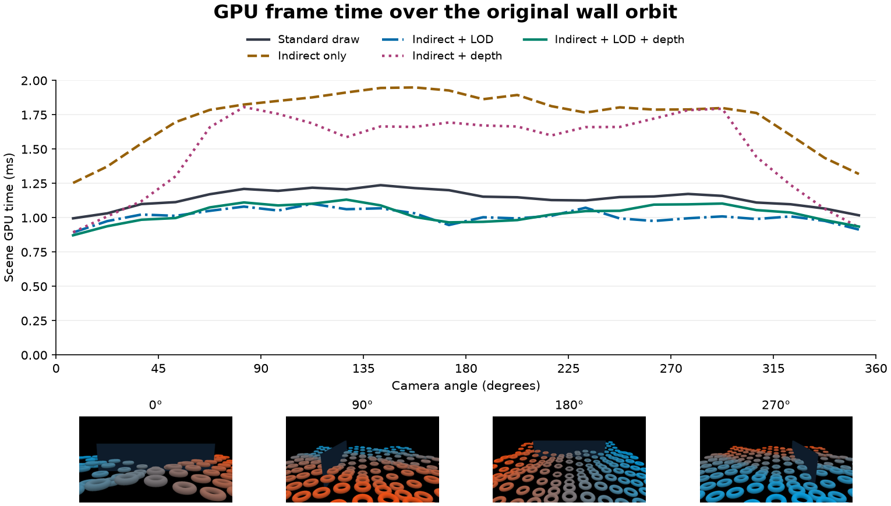

# DrawGeometryIndirectExample

Pin **DrawGeometryIndirectExample → Image** and play the timeline for an eight-bar orbit. The Mode dropdown selects the draw path. Enable **Benchmark** for a deterministic replay. For an adjacent-frame comparison of LOD with and without depth culling, enable **PairDepthModes** before starting the benchmark. The Log window prints the CSV path. Disable Benchmark between runs.

## Break-even on a GTX 1660 Ti

Across eight wall configurations and 120 camera angles, the first 10-percentage-point band with positive median savings on every pass was **over 10% through 20% of post-LOD triangles rejected**. Median savings were 0.035 ms in that band and 0.287 ms above 75% rejected. The original wall rejected just 4.6% at the median camera position, which explains why LOD alone remained slightly faster for its complete orbit.

| Triangles rejected | Wall/pose combinations | LOD only (ms) | LOD + depth (ms) | Paired savings (ms) | Five pass medians (ms) |
|---|---:|---:|---:|---:|---:|
| 0% | 419 | 1.083 | 1.118 | -0.032 | -0.040 to -0.028 |
| >0–10% | 257 | 1.071 | 1.070 | -0.009 | -0.010 to -0.003 |
| >10–20% | 131 | 1.097 | 1.026 | +0.035 | +0.015 to +0.058 |
| >20–30% | 22 | 1.094 | 0.978 | +0.103 | +0.090 to +0.119 |
| >30–50% | 53 | 1.002 | 0.821 | +0.155 | +0.132 to +0.177 |
| >50–75% | 34 | 0.921 | 0.784 | +0.131 | +0.059 to +0.142 |
| >75–100% | 44 | 0.756 | 0.473 | +0.287 | +0.279 to +0.291 |

Each pair repeats one camera pose on adjacent frames. The modes exchange order across poses and passes. Savings are the median of the within-pair time differences. The two timing columns are separate medians and can differ from their paired difference. The five-pass range describes repeatability on this machine. Hidden objects differ in size and screen area, so rejection percentage alone does not determine the savings. [All 4,800 frame pairs and GPU counts](depth-sweep.csv)

## Where the time went

The original reducer read the full current depth target in 14,400 workgroups at 1280 × 720. Each group produced one 8 × 8 tile maximum and used seven shared-memory barriers. The optimized reducer produces eight neighboring tiles per workgroup, with coalesced horizontal loads, one shared-memory barrier and 1,800 workgroups. A clear depth sample finishes its column early. MSAA reduction includes every sample that could increase the maximum.

The original classifier used a single invocation per part to scan its projected rectangle. Fully covered parts required the whole scan. The depth path now uses one 64-thread group per part. A center-tile test retains obviously visible parts immediately. For the rest, the lanes share the rectangle scan and keep the part if any tile fails the occlusion test. The depth-disabled path still classifies 64 parts per group. Both versions use the same conservative tile footprint, near-plane handling and depth bias.

| Wall | Version | Depth tile build (µs) | Classification (µs) | Indexed draw (µs) |
|---|---|---:|---:|---:|
| original | legacy | 182.3 | 65.8 | 817.0 |
| original | optimized | 42.0 | 43.0 | 829.4 |
| wide | legacy | 184.8 | 44.1 | 891.0 |
| wide | optimized | 50.6 | 40.8 | 886.8 |

With the original wall, tile-build time fell by **77%**. In the wide-wall views where all triangles were rejected, classification fell from **310.3 to 53.5 µs**. The legacy and optimized classifiers submitted identical part and triangle counts at every checked pose for both walls. Stage numbers are medians from a diagnostic replay with GPU timestamp boundaries and indirect-command readback. [Stage measurements](depth-stage-profile.csv)

For the end-to-end A/B check, both variants used LOD and depth culling. Legacy used the shaders and dispatch dimensions from commit `d3ba2162e`. The variants alternated at each pose within the same editor process. The timed replay used only the outer scene timestamps. The readbacks and internal timestamps ran separately.

| Wall | Legacy scene (ms) | Optimized scene (ms) | Paired savings (ms) |
|---|---:|---:|---:|
| original | 1.254 | 1.079 | +0.174 |
| wide | 1.376 | 1.220 | +0.195 |

[All 1,200 before/after frame pairs](depth-ab.csv)

## Original moving-camera benchmark

| Draw path | Median (ms) | P95 (ms) | 0–90° | 90–180° | 180–270° | 270–360° |
|---|---:|---:|---:|---:|---:|---:|
| Standard draw | 1.164 | 3.654 | 1.151 | 1.207 | 1.145 | 1.147 |
| Indirect only | 1.795 | 1.977 | 1.615 | 1.911 | 1.813 | 1.599 |
| Indirect + LOD | 1.008 | 1.154 | 0.995 | 1.043 | 1.005 | 0.968 |
| Indirect + depth | 1.599 | 1.829 | 1.006 | 1.677 | 1.665 | 1.344 |
| Indirect + LOD + depth | 1.030 | 1.169 | 0.992 | 1.081 | 1.025 | 1.033 |

The quarter-orbit columns are medians in milliseconds. Each plotted point is a 15° median. The five-mode run measures one complete orbit per mode and rotates their order across passes. GPU clocks were driver-managed. Use the adjacent-frame A/B figures above when comparing versions. [All 3,000 moving-camera timestamps](gpu-times.csv)

## Workload and reproduction

- Windows, TiXL Debug, Vulkan, NVIDIA GeForce GTX 1660 Ti, driver 610.88. The example renders a 1280 × 720 RGBA16F target with single-sample D32 depth. The GPU timestamps bracket the complete scene render, including the clear, wall, depth processing and drawing. Editor UI and presentation are outside the interval.
- The scene uses 225 toruses on a 15 × 15 grid, with 576 fine triangles or 64 coarse triangles per part. LOD switches below 100 projected pixels. The standard path draws a single combined full-detail mesh through GeometryToMesh and DrawMeshUnlit. Both paths draw the opaque wall first and keep hardware depth testing enabled.
- For the sweep, set the example's **WallSize** and **WallCenter** as below. Run the paired benchmark for each setting. Every pass warms up for 24 frames, then advances by 3° after each frame pair. Five passes give 600 pairs per wall. The original five-mode run warms up for 24 frames before each 120-frame orbit.
- For rejection counts, a separate profiling replay read the indexed indirect records after classification. Submitted triangles are the sum of indexCount × instanceCount / 3. The hidden fraction is one minus the depth-on count divided by the depth-off count at the same LOD and pose. The fraction excludes triangles already removed by frustum culling and LOD.
- Captured LOD images with depth culling on and off matched pixel-for-pixel at 0°, 90°, 180° and 270° on the default wall. GPU readback tests verify farthest-depth reduction on partial tiles, including a single uncovered sample in a 4× MSAA pixel.

| CSV wall ID | WallSize (X, Y, Z) | WallCenter (X, Y, Z) |
|---|---|---|
| none | 0.001, 0.001, 0.01 | 0, 1, 16 |
| original | 19, 4.5, 0.4 | 0, 1, 5 |
| narrow | 6, 10, 0.4 | 0, 2, 16 |
| medium | 18, 20, 0.4 | 0, 3, 16 |
| wide | 40, 30, 0.4 | 0, 3, 16 |
| innerSmall | 14, 12, 0.4 | 0, 2, 0 |
| inner | 36, 15, 0.4 | 0, 2, 0 |
| innerOffset | 28, 14, 0.4 | 0, 2, 8 |
